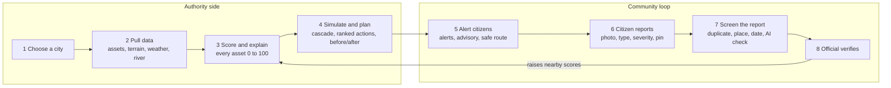
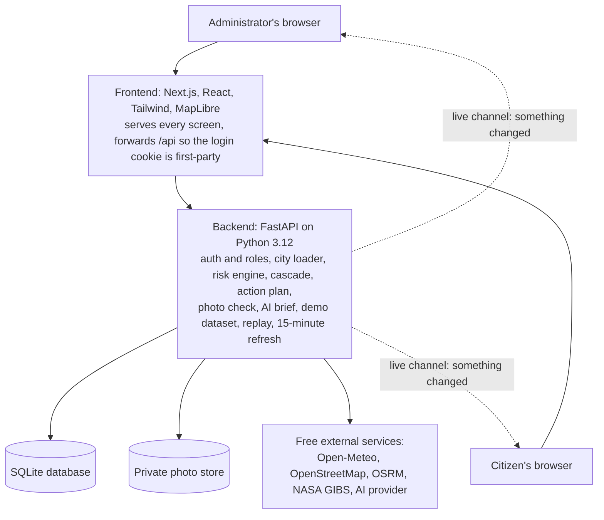

# InfraSentinel: Product Requirements Document

| | |
|---|---|
| Product | InfraSentinel (working prototype) |
| Problem statement | Critical Infrastructure Under Environmental Stress |
| Team | Devnox: Atharva Andhare, Sanket Kharche, Tanay Patil |
| Event | Hackyard Build 2026, IIT Guwahati |
| Code | https://github.com/AtharvaError/Hack_Yard_Devnox (branch `Branch1`) |
| Status | Working prototype on localhost; prepared for free hosting, not deployed |
| Document version | 1.0, October 2026 |

---

## 1. Summary

InfraSentinel turns a weather forecast into an asset-level action list for any city, using only free and open data.

An official types a city name. The platform pulls the city's hospitals, roads, bridges, power substations and water facilities from OpenStreetMap, adds terrain, the weather forecast and river levels, and then answers three questions:

1. **Which assets are at risk?** Every asset gets a risk score from 0 to 100 for the next 72 hours, with the reasons shown.
2. **What fails next?** A cascade simulator shows which other assets go down when one fails.
3. **What should be fixed first?** An action plan ranks preventive actions by risk removed per rupee, within the budget and crews available, and shows the city's risk before and after.

Citizens complete the loop. They receive alerts in their language, a safe route to a hospital that is not at risk, and a way to report damage with photos. An AI screens each photo, an official verifies it, and a verified report raises the risk score of nearby assets.

---

## 2. Problem

### 2.1 The problem

When a flood, landslide, heatwave or storm approaches, authorities receive a hazard warning for a district. They do not receive the answer they need: which specific assets are likely to fail, how serious the risk is for each, and what else fails as a knock-on effect. The hours of notice a forecast gives are spent guessing, crews and money are sent without a clear order of priority, and one failure causes others.

### 2.2 Who faces it

| Who | What goes wrong for them |
|---|---|
| City disaster management and municipal officials | Must decide where to send limited crews and money, without an asset-level picture |
| Operators of hospitals, power and water services | Their assets depend on each other, and nobody sees the chain |
| Citizens | Lose road access, power, water and emergency care; see damage first but have no trusted way to report it |
| Smaller cities and towns | Cannot afford paid risk data or specialist analysts |

### 2.3 Why it matters most for India

- India faces floods, cyclones, landslides and heatwaves every year, and its cities are dense and growing.
- Much infrastructure was built for calmer conditions, and essential services depend heavily on each other.
- Most municipalities have limited budgets and staff and cannot buy commercial risk data.
- Officials and citizens across states do not share one language.

### 2.4 What exists today

| Existing tool | What it does | What it leaves out |
|---|---|---|
| Google Flood Hub, GloFAS | River flood forecasts | Which assets are hit |
| IMD warnings, NDMA SACHET alerts | District-level warnings | Asset-level impact |
| ISRO Bhuvan, Copernicus EMS | Satellite disaster maps | Prevention; they mostly map after the event |
| FEMA Hazus, CDRI GIRI | Loss and risk modelling | Live data; built for experts |
| City GIS portals | Asset locations | Any reaction to changing weather |

**The gap:** no single tool joins live hazard, asset vulnerability, knock-on impact and a prioritised action list.

---

## 3. Goals, non-goals and success measures

### 3.1 Goals

1. Score every mapped critical asset in any city for the next 72 hours, with reasons an official can check.
2. Show the knock-on effect of failures through power, water and road-access links.
3. Produce a ranked, budget-aware preventive action list, and show its expected effect.
4. Give citizens alerts, a safe route and a reporting channel, in local languages and on a phone.
5. Use only free services, so any city can run it.

### 3.2 Non-goals for the prototype

- Replacing official warnings from IMD or NDMA.
- Engineering-grade structural assessment of individual assets.
- Calibrated probabilities of failure (scores are an explainable index; see section 8).
- Sending SMS or WhatsApp broadcasts automatically (needs a paid messaging service).

### 3.3 Success measures

| Measure | Target for the prototype | Achieved |
|---|---|---|
| Load a new city from live data | Under 60 seconds | Pune in about 34 seconds |
| Demo cities ready without any outside service | Instant | Pune and Kochi load at startup |
| Every score explained | 100% of scored assets list their reasons | Yes |
| AI photo check time | Under 10 seconds per report | 2 to 3 seconds on a free key (when a working key is set) |
| Data cost | ₹0 | ₹0 |
| Automated checks | Pass | 70+ checks on uploads, access rules and the AI path; feature tests in section 17 |

---

## 4. Users and roles

### 4.1 Roles

| Role | Who | Access |
|---|---|---|
| **Administrator** | City disaster cell, municipal engineer | Every screen: Command Centre, map, assets, cascade, scenarios, action plan, alerts, reports review, brief, safe route, users, settings |
| **Citizen (user)** | Any resident who signs up | Home, map, alerts, safe route, public advisory, report an issue |

New sign-ups always get the citizen role. An administrator can promote a user on the Users page.

### 4.2 Demo accounts

Shown on the login page and defined in `backend/app/config.py`:

| Role | Email | Password |
|---|---|---|
| Administrator | admin@hackyard.demo | Admin@12345 |
| Citizen | user@hackyard.demo | User@12345 |

These are public demo values. Change them and set `DEMO_MODE=false` before any real deployment.

### 4.3 User stories

| As a… | I want to… | So that… |
|---|---|---|
| Duty officer | see the city's risk, top risks and next actions on one screen | I can brief my chief in a minute |
| Engineer | know why an asset scored high | I can check the reason on the ground |
| Planner | see what fails when a bridge goes | I can protect the right asset first |
| Commissioner | see how much risk a budget removes | I can justify spending |
| Officer | assign actions to crews and follow them | nothing is forgotten |
| Citizen | know if my area is safe, in my language | I can decide whether to travel |
| Citizen | get a route to a hospital that is not at risk | I avoid flooded bridges |
| Citizen | report damage with a photo | the authority hears about it quickly |
| Officer | have photos screened before I see them | I do not waste time on spam or old pictures |

---

## 5. Features and acceptance criteria

Each feature below is built and working in the prototype unless marked otherwise.

### 5.1 Sign-in and roles
- Email and password sign-in; self-registration creates a citizen account.
- Session is a signed token (JWT) in an httpOnly cookie, valid for 12 hours.
- Passwords are hashed with Argon2.
- **Accept:** a citizen cannot open administrator pages or call administrator APIs (returns 403).

### 5.2 City search and loading
- Search any place name (Open-Meteo geocoding).
- Loading a new city fetches assets within 7 km of the centre, terrain, forecast and river flow, infers links and stores everything.
- A city within 2 km of an already loaded city is reused, not reloaded.
- **Accept:** a new city opens in 20 to 60 seconds; a busy map server shows a "try again in a minute" message.

### 5.3 Command Centre (administrator home)
- Five headline numbers: city risk score, assets at risk, hospitals that may be cut off, rain in 24 hours, river level.
- Map of all assets coloured by risk, with a **72-hour playback** (slider and play button, 6-hour steps).
- Top five risks (click one to open the asset panel) and the next three actions.
- Risk outlook chart, risk by hazard, weather, risk by zone, and assets by level.
- **Accept:** pressing Play moves the whole screen forward 6 hours every 1.8 seconds until +72 h.

### 5.4 Asset panel
- Score, level and a bar per hazard with a plain-language reason (for example "108 mm rain in 24 h, river at 2.1x normal, low-lying site, 61 m from a waterway").
- The asset's own 72-hour outlook.
- Recommended action with risk before and after, cost and crews, and an **Assign a crew** button.
- **If this fails:** the assets that rely on it, with a **Simulate this failure** button that opens the cascade simulator with the asset already chosen.
- Elevation, slope, distance to water, and people served (estimate).

### 5.5 Live map
- All assets, filterable by type; hover for name and level; click for the asset panel (administrator) or a simple status card (citizen).
- **Relief points layer:** schools, community halls and shelters from OpenStreetMap (80 per demo city), labelled as possible relief points, not official shelters.
- **Satellite layer:** NASA MODIS true-colour image for any past date, to compare before and after an event.

### 5.6 Assets list
- Every asset ranked by risk, filterable by name and type.

### 5.7 Cascade simulator
- Pick assets to fail, or fail every critical asset at once.
- The failure spreads in waves, shown one wave per second on the map with dotted dependency lines.
- Impact panel: assets affected, knock-on failures, hospitals affected, people affected (estimate), and a list of what happens to each.

### 5.8 Scenarios (stress tests)
| Scenario | What it sets |
|---|---|
| Cloudburst | 200 mm rain in 24 h, 150 mm in the 3 days before, river at 2× normal |
| River flood | 90 mm rain, 220 mm before, river at 4× normal |
| Severe heatwave | Feels-like 48 °C |
| Cyclonic storm | 150 mm rain, 80 mm before, 120 km/h gusts, river at 1.8× |

- Each value replaces the live reading only when it is more severe.
- Applying a scenario changes every administrator screen until it is cleared.
- **Replay a past date:** score the city against the weather recorded on any date from 1984 to ten days ago (Open-Meteo archive). Uses today's assets and links, so it is a check, not a reconstruction.

### 5.9 Action plan
- Every asset scoring 20 or more gets one action matched to its main hazard and type (18 preset actions plus 4 fallbacks), each with an indicative cost in lakh rupees, crews and share of risk removed.
- Ranking: benefit per cost, where benefit = score × share removed × criticality × (1 + 0.5 × number of assets that depend on it).
- Optional budget and crew limits; actions that do not fit are listed as deferred with the reason.
- **What if we act?** A budget slider shows the city score, assets at risk and isolated hospitals before and after the selected actions, and which asset types the reduction comes from.
- **Crew tasks:** Assign an action to a named crew; track it as assigned, in progress or done; one open task per asset.

### 5.10 Alerts
- Administrators send advisory, warning or emergency alerts to everyone viewing the city; they appear instantly through the live channel.
- Every alert has a **Share on WhatsApp** link that opens WhatsApp with the text ready to send (free; uses the sender's own account).

### 5.11 Citizen reports with photos
- Pin the location on the map; the address fills itself in; choose damage type and severity (minor, serious, dangerous); add up to 3 photos.
- Screening pipeline in section 10.1.
- Administrator review queue: pending, verified, rejected, with the AI label, flags and photos.
- A verified report adds 4, 8 or 12 points (by severity) to every asset within 400 m, capped at 20.
- Limit: 10 reports per citizen per day.

### 5.12 Situation brief and public advisory (AI)
- Administrator: a situation brief with overall risk, most exposed assets and recommended actions; copy or save as PDF.
- Citizen: a public advisory with plain do's and don'ts, **in the language they picked** when an AI key is set.
- Details in section 10.2.

### 5.13 Safe route
- From the citizen's location to the nearest hospital that is not at high or critical risk (OSRM driving route).
- Checks alternative routes and reports any high-risk road or bridge within 120 m of the route.

### 5.14 Risk by zone
- The analysed area split into a three-by-three compass grid (North-west to South-east), with assets at risk out of those monitored. Not official wards.

### 5.15 Phone layout and languages
- Under 768 px wide, the sidebar becomes a bottom tab bar.
- Citizen home: area status (Safe, Caution, Danger), two large buttons (safe route, report damage), latest alerts with WhatsApp sharing, essential services, emergency (call 112, relief points), and risk by area.
- Language switch: English, Hindi, Marathi, Malayalam for the citizen home and navigation. Other screens are English. Translations are not yet reviewed by native speakers.
- If the server cannot be reached, the citizen home shows the last alerts it loaded. The app does not yet open fully offline.

### 5.16 Data source switch (demo, live, replay)
- Pune and Kochi open in **demo mode**: real asset snapshots scored against a modelled storm, labelled "Demo data" in the top bar, sidebar and dashboard.
- An administrator can switch a demo city to the live forecast and back with one click.
- Replay mode shows "Replay of YYYY-MM-DD".

### 5.17 Settings
- Data sources and refresh schedule, a Refresh now button, and the activity (audit) log.
- **Import real links:** download the current links as CSV; upload a CSV of real links (`source,target,kind`) to add to or replace the distance-based estimates. Row-by-row problems are reported.

### 5.18 Users
- List users; change a user's role between administrator and citizen.

---

## 6. How the prototype works: end-to-end workflow

### 6.1 Workflow diagram



### 6.2 What happens at each step

1. **Choose a city.** The search box sends the name to Open-Meteo's geocoder. Picking a result calls `POST /api/cities/load`.
2. **Pull data.** The backend:
   - queries OpenStreetMap (Overpass API, three mirrors with retries) for hospitals, fire stations, substations, power plants, water works and pumping stations, bridges on major roads, and named major roads, inside a 7 km box;
   - queries rivers, canals and streams to measure each asset's distance to water;
   - asks Open-Meteo for each asset's elevation and works out the slope;
   - fetches the hourly forecast (rain, temperature, feels-like temperature, gusts) for 3 past days and 6 coming days, and daily river discharge for the past 90 days and next 7 (GloFAS through Open-Meteo);
   - infers links: each hospital, water facility and fire station takes power from its nearest substation; each hospital takes water from its nearest water facility; each hospital and fire station relies on its two nearest roads or bridges within 2.5 km for access; each substation takes power from a plant within 15 km.
3. **Score and explain.** For the chosen 24-hour window, every asset gets a score per hazard and an overall score (section 8). Scores are recomputed on every request, so changing time or scenario is instant.
4. **Simulate and plan.** The cascade simulator walks the dependency graph; the planner ranks actions; the what-if view rescores with the planned actions applied.
5. **Alert citizens.** Alerts are stored and pushed to open screens over the WebSocket. Citizens see them on their home screen and can share them on WhatsApp.
6. **Citizen reports.** The browser shrinks each photo and reads its date and location before the metadata is removed.
7. **Screen the report.** The server re-encodes the photo, runs duplicate, place and date checks, then the AI check (section 10.1).
8. **Official verifies.** A verified report adds points to assets within 400 m, and every screen refreshes.

Every 15 minutes the backend refreshes each city's weather (live forecast, demo storm or replay) and tells open screens to update.

### 6.3 Step-by-step walkthrough: administrator

1. Open the app and sign in as the demo administrator.
2. The Command Centre opens on a demo city (Kochi or Pune). Read the five headline numbers.
3. Press **Play 72 h** to watch risk change over the next three days. Drag the slider to any time.
4. Click the top risk, for example Dengle Bridge. Read why it scored 71, its outlook, and the recommended action.
5. Press **Simulate this failure**, then **Run simulation**. Watch the failure spread and read the impact panel.
6. Open **Action Plan**. Move the budget slider in "What if we act?" and compare before and after.
7. Press **Assign** on an action, name a crew, and change its status in "Crew tasks".
8. Open **Scenarios**, apply **Cloudburst**, and see every screen change. Try **Replay a past date**.
9. Open **Alerts** and send a warning.
10. Open **Reports**, review a citizen report and its AI label, and verify or reject it.
11. Open **AI Brief** and save the brief as a PDF.
12. In **Settings**, download the links CSV, or upload real ones.

### 6.4 Step-by-step walkthrough: citizen

1. Sign up or sign in as the demo citizen. On a phone, the bottom tab bar appears.
2. Choose your language in the top bar.
3. The home screen shows your area's status and what to do.
4. Press **Safe route to a hospital**, allow location or tap the map, and follow the route.
5. Press **Report damage**: pin the spot, pick the type and severity, add a photo, send.
6. Read **Alerts** and share one on WhatsApp.
7. Open **Advisory** to read the public advisory in your language.

---

## 7. Screens

| Screen | Path | Who |
|---|---|---|
| Login and sign-up | `/login` | Everyone |
| Command Centre / Home | `/dashboard` | Admin / Citizen |
| Live Map | `/map` | Both |
| Assets | `/assets` | Admin |
| Cascade Simulator | `/cascade` | Admin |
| Scenarios | `/scenarios` | Admin |
| Action Plan | `/plan` | Admin |
| Alerts | `/alerts` | Both |
| Reports | `/reports` | Both (review queue for admin, own reports for citizens) |
| AI Brief / Advisory | `/brief` | Both |
| Safe Route | `/route` | Both |
| Users | `/users` | Admin |
| Settings | `/settings` | Admin |

Layout: fixed left sidebar on desktop (never scrolls); top bar with city search, data-source label, language switch, time buttons (Now, +24h, +48h, +72h) and alerts bell; bottom tab bar on phones.

---

## 8. Risk model

### 8.1 Hazard intensity (0 to 1), for a 24-hour window

Readings: `rain24` (rain in the window), `antecedent` (rain in the 72 hours before), `apparent_max` (highest feels-like temperature), `gust` (highest gust), `river_ratio` (highest river discharge in the window ÷ median of the past 90 days).

| Hazard | Formula |
|---|---|
| Flood | 0.55 × clamp(rain24 / 120) + 0.20 × clamp(antecedent / 200) + 0.25 × clamp((river_ratio − 1) / 2) |
| Heat | clamp((apparent_max − 34) / 14) — starts at 34 °C, full at 48 °C |
| Landslide | 0.7 × clamp(rain24 / 100) + 0.3 × clamp(antecedent / 200) |
| Wind | clamp((gust − 45) / 55) — starts at 45 km/h, full at 100 km/h |

### 8.2 Exposure of the location (0 to 1)

- `lowness` = share of the city's assets that sit higher than this one.
- `flatness` = 1 − clamp(slope / 0.08).
- `near_water` = clamp(1 − distance to water / 1500 m).

| Hazard | Exposure |
|---|---|
| Flood | 0.45 × lowness + 0.15 × flatness + 0.40 × near_water |
| Heat | 1 |
| Landslide | clamp(slope / 0.20) |
| Wind | 1 |

### 8.3 Vulnerability of the asset type

| Type | Flood | Heat | Landslide | Wind |
|---|---|---|---|---|
| Hospital | 0.70 | 0.60 | 0.50 | 0.30 |
| Substation | 0.90 | 0.80 | 0.50 | 0.60 |
| Power plant | 0.80 | 0.70 | 0.50 | 0.50 |
| Bridge | 0.85 | 0.35 | 0.70 | 0.50 |
| Road | 0.75 | 0.35 | 0.85 | 0.20 |
| Water facility | 0.80 | 0.40 | 0.50 | 0.20 |
| Fire station | 0.60 | 0.30 | 0.50 | 0.30 |

### 8.4 Asset score and level

- Per hazard: `risk_h = intensity_h × exposure_h × vulnerability_h`.
- Combined: `score = 100 × (1 − Π(1 − risk_h))`, plus verified-report points (4, 8 or 12 per report within 400 m, capped at 20), capped at 100.
- Levels: **low** under 20, **moderate** 20 to 44, **high** 45 to 69, **critical** 70 and above.
- Citizens see Safe (low), Caution (moderate) and Danger (high or critical).
- A reason is listed for every hazard contributing at least 3 points.

### 8.5 City score (0 to 1000)

`10 × (0.5 × criticality-weighted average score + 0.5 × average of the worst 10%)`. Criticality weights: hospital 1.0, substation 0.9, power plant 0.9, water 0.85, fire station 0.8, bridge 0.7, road 0.5. Blending in the worst tenth keeps a few critical assets visible in a mostly calm city.

### 8.6 Cascade rules

The failure spreads in waves until nothing changes:
- A **water facility** that loses power **fails** (and passes the failure on).
- An asset whose every access road or bridge is down is **isolated**.
- A hospital or fire station that loses power goes **on backup power**; other assets are **degraded**.
- Losing water supply means **degraded**; losing some access routes means **access reduced**.
- "People affected" = the city population split evenly across assets of the same serving type (hospital, substation, water). An estimate only.

### 8.7 Isolated hospitals

A hospital is flagged as "may be cut off" when every road or bridge it relies on for access is at high or critical risk.

---

## 9. Other algorithms

| Feature | Rule |
|---|---|
| Action ranking | Greedy by benefit ÷ cost; stops adding when budget or crews run out (a standard, explainable approach to the knapsack problem) |
| What if we act? | Rescores with each selected action's asset set to its "risk after" value, then recomputes city score, assets at risk and isolated hospitals |
| Zones | Assets split into a 3 × 3 grid by latitude and longitude; each zone shows assets at high or critical risk and its average score |
| Safe route | Nearest hospital at low or moderate risk; OSRM driving routes with alternatives; any high-risk road or bridge within 120 m of the route is listed |
| Demo storm | Hourly series anchored to the current hour: steady rain for the 3 past days, a mid-day burst each day falling to 60%, 30%, 10% and 5% of the peak day; gusts and river flow ease with it |
| Replay | Fetches the archive for 3 days before to 6 days after the date (and 90 days of river flow), then shifts every timestamp so the date lines up with today |

---

## 10. AI in the prototype

AI is used in two places, both through one free key. In both, **the AI advises and a person decides**, and the facts come from the risk model, not the AI.

### 10.1 AI photo screening of citizen reports

**Pipeline, in order:**

1. **In the browser:** the photo is shrunk, and its date and GPS position are read before upload.
2. **On the server:** the photo is re-encoded as JPEG at most 1600 px on the long side, which strips all metadata; it gets a random file name and is served only to administrators and its sender.
3. **Basic checks**, each adding a flag:
   - exact duplicate (SHA-256) or near-duplicate (perceptual hash) of an earlier photo;
   - taken more than 1 km from the pinned spot;
   - taken more than 7 days ago.
4. **AI check:** a vision language model receives smaller copies of the photos (600,000 pixels shared across the report's photos, about 2,200 tokens instead of about 8,000) and the citizen's claim, and must answer with strict JSON:
   - `real_photo`, `shows_infrastructure`, `shows_damage`, `matches_claim`, `severity`, `inappropriate`, `confidence`, `reason`.
   - The system prompt tells the model to treat any text inside a photo as part of the scene, never as instructions.
   - The answer is parsed and every field is forced into the expected type and range.
5. **Label for the official:**

| Label | Meaning |
|---|---|
| Likely genuine | Real photo, damage visible, matches the claim, no flags |
| Needs review | Unclear, duplicate, wrong place or date, low confidence, or not a real photograph (drawing, screenshot) |
| Likely irrelevant | No infrastructure or no damage visible |
| Inappropriate | Content unsuitable for staff; the photo is hidden |
| Not AI-checked | No key, or the AI was unavailable; basic checks still apply |

6. **Official decides:** verify or reject. The AI never verifies or rejects a report, and citizens never see its verdict.

**Resilience:** the provider's model list is checked and the first model that accepts images is remembered; when the provider says "slow down" (HTTP 429) the check waits as told (up to 70 seconds, twice); interrupted checks are retried at startup; an administrator can re-run a check.

### 10.2 AI-written situation brief and public advisory

1. The risk model fills a fixed template: overall risk, weather, assets at risk by type, the five most exposed assets with reasons, and the top five actions (administrator); or plain do's and don'ts for the main hazard (citizen).
2. If an AI key is set, the AI rewrites the template for the audience (concise and action-oriented for officials; simple and reassuring for the public) and, for citizens, **in their chosen language** (English, Hindi, Marathi or Malayalam).
3. The prompt says to keep names and numbers exactly, and to add no facts, numbers, places or advice.
4. Model "thinking" text is removed before display.
5. If there is no key, or the AI is busy, the template is shown instead, with a note saying why.
6. The footer says which AI wrote it and asks the reader to check names and numbers before sharing.

### 10.3 Supported AI providers and setup

| Provider | Key starts with | Notes |
|---|---|---|
| Groq | `gsk_` | Free tier; the prototype was tested with it (about 8,000 tokens a minute, 1,000 requests a day, so about two photo checks a minute) |
| Gemini (Google) | `AIza` | Free tier |
| Grok (xAI) | `xai-` | Normally paid per use |
| Any OpenAI-compatible service | any | Set `VISION_BASE_URL` (and `VISION_MODEL`) as well |

Setup:
1. Create a free key with the provider (for Groq: sign in at console.groq.com and create an API key).
2. Put it in `backend/.env` as `VISION_API_KEY=...`. Never paste it in chat or commit it; `.env` is ignored by git.
3. Restart the backend. Settings shows the photo check as enabled.

> **Current state:** the key now in `backend/.env` starts with `xpl_`, which matches none of the providers above, so both AI features are switched off until a supported key is set or `VISION_BASE_URL` points at the matching service. The AI brief was tested with a stand-in service; the photo check was tested earlier with a real Groq key.

### 10.4 Planned AI (not built)

- Calibrate the risk weights with machine learning against recorded floods and outages.
- Detect flood extent from Sentinel-1 radar images.
- Translate alerts automatically when they are sent.

---

## 11. Data: what is real, what is modelled, and whether synthetic data was used

**Short answer: yes, some data is synthetic or estimated, and every such item is labelled in the app.** The infrastructure itself is real.

| Data | Real or synthetic | Source |
|---|---|---|
| Assets (hospitals, roads, bridges, substations, water, fire stations) | **Real** | OpenStreetMap (Overpass API). Pune and Kochi are saved snapshots of the real data |
| Elevation and slope | **Real** (90 m terrain model) | Open-Meteo elevation API |
| Distance to water | **Real** | OpenStreetMap waterways |
| Live weather forecast | **Real** | Open-Meteo forecast API |
| River flow (live) | **Real**, modelled forecast | GloFAS through Open-Meteo flood API |
| Past-date weather (replay) | **Real**, recorded | Open-Meteo historical archive |
| Relief points | **Real** | OpenStreetMap schools, community halls, shelters |
| City population | **Real** | Open-Meteo geocoding (GeoNames) |
| Routes | **Real** | OSRM public server on OpenStreetMap roads |
| Satellite images | **Real** | NASA GIBS (MODIS) |
| **Demo storm weather for Pune and Kochi** | **Synthetic (modelled)** | Generated by `backend/app/services/demo.py` from the values in `backend/demo_data/*.json` |
| **River flow in demo mode** | **Synthetic** | A flat baseline with a raised peak |
| **Links between assets** | **Estimated** (inferred by distance, not surveyed) | Rules in section 6.2; replace with real ones by CSV import |
| **Action costs, crews, risk removed** | **Planning assumptions** | Table in `backend/app/services/plan.py` |
| **People served and affected** | **Estimate** | City population split evenly across assets of a type |
| **Test photos** | **Synthetic** | Generated images used only in automated tests, not shipped |

Demo storm values:

| City | Label | Rain 24 h | Rain 3 days before | Gusts | Feels-like max | River |
|---|---|---|---|---|---|---|
| Pune | Heavy monsoon rain day | 108 mm | 115 mm | 50 km/h | 30 °C | 2.1× |
| Kochi | Monsoon depression with strong winds | 115 mm | 150 mm | 72 km/h | 31 °C | 1.8× |

---

## 12. Getting real, ready-made data: step-by-step guide

> I wrote these steps from my knowledge of these services and have not opened each website to confirm its current layout. Menus and links may have moved; the service names are stable.

### 12.1 The easiest: live data for any city (already built in)

1. Sign in as administrator.
2. Type the city name in the top search box and pick the right result.
3. Wait 20 to 60 seconds. The app fetches real assets, terrain, forecast and river flow.
4. For Pune or Kochi, click the yellow **Demo data** label in the top bar to switch to the live forecast. Click **Use demo data** to switch back.

### 12.2 Real weather of a past flood (already built in)

1. Open **Scenarios** → **Replay a past date**.
2. Enter the date of a known event, for example a well-reported flood in that city.
3. Press **Replay this date**. Every screen now uses the weather recorded that day.
4. Check whether the high-scoring assets are where the damage was reported.
5. Click the "Replay of …" label in the top bar to end the replay.

To see the raw numbers yourself: open the Open-Meteo **Historical Weather API** page (open-meteo.com, Docs → Historical Weather), enter the city's latitude and longitude and the dates, tick precipitation and wind gusts, and download CSV.

### 12.3 Real links between assets (already built in)

The best real data is the utility and road department's own records of which substation feeds which hospital, and which roads reach it.

1. In **Settings → Import real links**, press **Download current links**. This CSV is also the template.
2. Ask the city's electricity distribution company, water board and roads department for feeder and access records, or build them with their engineers.
3. Fill one row per link: `source,target,kind`, where the target relies on the source, and kind is `power`, `water` or `access`. Names must match the asset names in the app (copy them from the downloaded file or the Assets page).
4. Save as CSV (UTF-8).
5. Press **Upload CSV**. Tick **Replace all existing links** to remove the estimated ones. The result lists rows that were skipped and why.

### 12.4 OpenStreetMap data you can download yourself

**Option A: one city, in the browser (Overpass Turbo)**
1. Open overpass-turbo.eu.
2. Move the map to your city.
3. Paste a query, for example:
   ```
   [out:json][timeout:60];
   (
     nwr["amenity"="hospital"]({{bbox}});
     nwr["power"="substation"]({{bbox}});
     way["bridge"]["highway"]({{bbox}});
   );
   out center tags;
   ```
4. Press **Run**, then **Export** → GeoJSON or CSV.

**Option B: a whole state or India (Geofabrik)**
1. Open download.geofabrik.de → Asia → India.
2. Download the region's `.osm.pbf` (full data) or shapefile.
3. Open it in QGIS (free) and filter by tags such as `amenity=hospital`.

The prototype does not yet import asset files directly; it fetches OpenStreetMap itself. Asset import is on the roadmap (section 19).

### 12.5 Indian government and agency data

| Need | Where to look | How |
|---|---|---|
| Hospitals, health facilities, district data | Open Government Data Platform: data.gov.in | Search a topic (for example "hospital directory"), open a dataset, download CSV, or register for a free API key |
| Satellite maps, flood maps, thematic layers | ISRO Bhuvan: bhuvan.nrsc.gov.in | Open the relevant portal (for example disaster services), browse layers, and use the download options where offered |
| Weather warnings and observed rain | India Meteorological Department: mausam.imd.gov.in | Read district warnings; observed and gridded rainfall data is available through IMD's data services |
| Disaster alerts | NDMA SACHET: sachet.ndma.gov.in | View current alerts by state and type |
| River flood forecasts worldwide | GloFAS: globalfloods.eu | View forecasts; data downloads need a free Copernicus account |
| City GIS layers | The city's Smart City or municipal GIS portal | Varies by city; many publish ward boundaries and asset layers |

How these could feed the prototype:
- **Ward boundaries** → replace the 3 × 3 zones with real wards (roadmap).
- **Hospital directories** → check or add hospitals missing from OpenStreetMap.
- **IMD observed rainfall** → validate replay results.
- **Utility feeder data** → import as links (section 12.3).

---

## 13. Architecture



- The browser only talks to the frontend; `/api` calls are forwarded to the backend, so the session cookie stays first-party and no cross-site setup is needed.
- The live channel (WebSocket `/ws/live`) carries only "something changed" signals; screens then fetch data through the secured API, so no data leaks over it.

### 13.1 Technology stack

| Layer | Technology |
|---|---|
| Frontend | Next.js 16, React 19, TypeScript, Tailwind CSS 4 |
| Maps and charts | MapLibre GL 5, OpenFreeMap tiles, Recharts 3 |
| Backend | FastAPI, Uvicorn, Python 3.12 |
| Database | SQLite through SQLAlchemy 2.0 (PostgreSQL possible) |
| Graph | NetworkX |
| Security | PyJWT, Argon2 |
| Images | Pillow (server), exifr (browser) |
| HTTP | httpx |
| AI | Any OpenAI-compatible vision model; Groq tested |

### 13.2 Data model

| Table | Holds |
|---|---|
| users | email, name, password hash, role |
| cities | name, country, state, centre, population, radius, cached weather and river data, data mode (live, demo, replay), replay date |
| assets | city, OpenStreetMap id, name, type, location, elevation, slope, distance to water |
| dependencies | city, source asset, target asset, kind (power, water, access) |
| alerts | city, title, message, severity, author, time |
| reports | city, user, location, address, damage type, severity, description, status, AI label, reason, confidence, source, flags |
| report_photos | report, file name, SHA-256, perceptual hash, photo date and GPS |
| tasks | city, asset, action, crew, status, author, times |
| places | city, kind, name, location (relief points) |
| audit_log | who did what, when |

### 13.3 API (all under `/api`)

| Area | Endpoints |
|---|---|
| Auth | `POST /register`, `POST /login`, `POST /logout`, `GET /me`, `GET /demo-accounts` |
| Cities | `GET /geocode`, `GET /cities`, `POST /cities/load`, `POST /cities/{id}/refresh`, `POST /cities/{id}/data-mode` |
| Risk | `GET /scenarios`, `GET /cities/{id}/overview`, `GET /cities/{id}/assets/{asset}`, `GET /cities/{id}/zones` |
| Analyse | `POST /cities/{id}/cascade`, `GET /cities/{id}/plan`, `GET /cities/{id}/plan/effect` |
| Tasks | `GET` and `POST /cities/{id}/tasks`, `PATCH` and `DELETE /tasks/{id}` |
| Links | `GET /cities/{id}/links/export`, `POST /cities/{id}/links/import` |
| Citizens | `GET /cities/{id}/brief?lang=`, `GET /cities/{id}/route`, `GET /cities/{id}/places`, `GET /reverse-geocode` |
| Community | `GET`, `POST /alerts`, `DELETE /alerts/{id}`, `GET /report-options`, `GET`, `POST /reports`, `GET /reports/photos/{id}`, `PATCH /reports/{id}`, `POST /reports/{id}/recheck` |
| Admin | `GET /users`, `PATCH /users/{id}`, `GET /audit`, `GET /sources` |
| Live | WebSocket `/ws/live` |

Most time-dependent endpoints accept `horizon` (0 to 72 hours) and `scenario`.

---

## 14. Security and privacy

- Passwords hashed with Argon2; sessions in an httpOnly cookie; `COOKIE_SECURE=true` on https.
- Role checks on every administrator endpoint.
- Photos: metadata stripped, random file names, served only to administrators and the sender, 5 MB and 40-megapixel limits, at most 3 per report, 10 reports per user per day.
- The AI never sees the reporter's identity; text inside photos is treated as scene content, not instructions.
- The AI key lives only in `backend/.env`, which git ignores.
- Every administrator action is written to the audit log.
- Before real use: change the demo passwords, set `DEMO_MODE=false`, set a strong `JWT_SECRET`.

---

## 15. Non-functional requirements

| Area | Requirement / current behaviour |
|---|---|
| Performance | New city 20 to 60 s; demo cities instant; score recalculation per request under a second for about 165 assets |
| Freshness | Weather refreshed every 15 minutes |
| Resilience | Three Overpass mirrors with retries; a failed weather refresh keeps the last good forecast; AI failures fall back to templates |
| Cost | ₹0: every data source is free; the AI runs on a free tier |
| Accessibility | Keyboard-reachable controls, labels on icon buttons, alt text on images, colour plus text for levels |
| Devices | Desktop layout; phone layout under 768 px |
| Languages | Citizen home and navigation in four languages |

---

## 16. Setup, run and deploy

### 16.1 Run on your computer (Windows)

1. Install Python 3.12 and Node.js 20 or later.
2. Clone the repository and open the folder in PowerShell.
3. Run `.\start.ps1`. It creates the Python environment, installs everything and opens two windows: backend on port 8000, frontend on port 3000.
4. If those ports are taken: `.\start.ps1 -ApiPort 8100 -WebPort 3100`.
5. Open http://localhost:3000 and sign in with a demo account.
6. Optional: put an AI key in `backend/.env` (section 10.3).

### 16.2 Deploy for free

| Part | Host | Steps |
|---|---|---|
| Backend | Render | New → Blueprint → pick the repository; `render.yaml` sets it up and generates `JWT_SECRET`; add `VISION_API_KEY` in the dashboard |
| Frontend | Vercel | Import the repository, Root Directory `frontend`, set `API_URL` to the Render address and `NEXT_PUBLIC_WS_URL` to `wss://<render address>/ws/live` |

Free-plan limits: the backend sleeps when idle (about a minute to wake), and has no permanent disk, so new accounts, cities and photos are lost on restart. Demo accounts and demo cities come back on every start.

### 16.3 Configuration (`backend/.env`)

| Variable | Default | Purpose |
|---|---|---|
| `JWT_SECRET` | development value | Signs sessions; change before deploying |
| `COOKIE_SECURE` | false | true on https |
| `DEMO_MODE` | true | Shows demo accounts on the login page |
| `DEMO_ADMIN_EMAIL`, `DEMO_ADMIN_PASSWORD`, `DEMO_USER_EMAIL`, `DEMO_USER_PASSWORD` | see section 4.2 | Demo accounts |
| `VISION_API_KEY` | empty | AI key for photo check and brief |
| `VISION_PROVIDER`, `VISION_MODEL`, `VISION_BASE_URL` | auto | Override provider detection |
| `GEMINI_API_KEY`, `GEMINI_MODEL` | empty, gemini-2.5-flash | Gemini-only setup |
| `DATABASE_URL` | SQLite file | Use PostgreSQL in production |
| `CITY_RADIUS_KM` | 7 (max 15) | Area analysed |
| `REFRESH_MINUTES` | 15 | Weather refresh |
| `REPORTS_PER_DAY` | 10 | Report limit per citizen |
| `UPLOAD_DIR` | backend/uploads | Photo store |

---

## 17. Testing done

- 70+ automated checks on photo uploads, access rules and the AI path, including a real Groq check.
- Feature tests on a copy of the database: plan effect (Pune 541 → 302 with all 163 actions; 541 → 518 with a ₹150 lakh budget, 19 actions), zones, asset outlook and action, crew tasks (create, duplicate refused, update), CSV export and import (bad names and kinds reported), relief points (80 each for Pune and Kochi), past-date replay (Kochi, 15 August 2018: 84 mm rain, river 3× normal, city score 588), and role checks (403 for citizens on admin endpoints).
- AI brief tested against a stand-in AI service: Hindi requested, thinking text removed, template used when the AI is busy.
- Browser checks: every new screen loads without errors; 72-hour playback, the asset-panel-to-cascade hand-off and the language switch work.
- TypeScript type check and production build pass.

Not yet tested: the AI check on real photographs of damage; crew assignment, CSV upload and replay started from the browser (their backend is tested).

---

## 18. Known limitations and risks

| Limitation | Effect | Mitigation |
|---|---|---|
| Links estimated from distance | Cascade results are indicative | CSV import of real links |
| Weights not calibrated | Scores are an index, not a probability | Replay past events; calibrate (roadmap) |
| Demo cities use a modelled storm | Not today's weather | Labelled on screen; one-click switch to live |
| Costs, crews, people are assumptions | Plan totals are estimates | Labelled as estimates |
| Free AI tier limits | About two photo checks a minute | Waits and retries; basic checks always run |
| No working AI key at present | AI features off | Set a Groq, Gemini or xAI key |
| Translations unreviewed | Possible wording errors | Native-speaker review |
| No full offline mode | App needs the server | Last alerts kept on the device |
| Free hosting has no permanent disk | Data lost on restart | Hosted database and photo storage |
| OpenStreetMap coverage varies | Some assets may be missing or unnamed | Asset import (roadmap) |

---

## 19. Roadmap

1. **Bulk import of assets** from city records, alongside the existing link import.
2. **Calibration** of weights against recorded floods and outages, possibly with machine learning.
3. **Sentinel-1 radar flood mapping** for true before and after views.
4. **Real ward boundaries** instead of compass zones.
5. **Full offline mode** for citizens (installable app with a service worker).
6. **SMS and WhatsApp broadcast** through a messaging provider.
7. **Native-speaker review** of translations and more languages.
8. **Deployment** with a hosted database and photo storage.

---

## 20. Glossary

| Term | Meaning |
|---|---|
| Asset | A hospital, road, bridge, substation, power plant, water facility or fire station |
| Horizon | How far ahead the 24-hour window starts: now, +24 h, +48 h or +72 h (any 6-hour step on the Command Centre) |
| Intensity | How strong a hazard is in the window, 0 to 1 |
| Exposure | How exposed the location is to that hazard, 0 to 1 |
| Vulnerability | How badly that type of asset suffers from that hazard, 0 to 1 |
| Cascade | Failures that spread through power, water and road-access links |
| Isolated hospital | A hospital whose every access route is at high or critical risk |
| Demo mode | Real assets scored against a modelled storm |
| Replay | Real assets scored against the weather recorded on a past date |
| Relief point | A school, community hall or shelter that could be used in an emergency |
